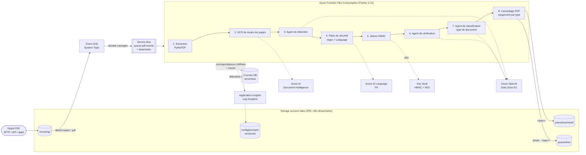
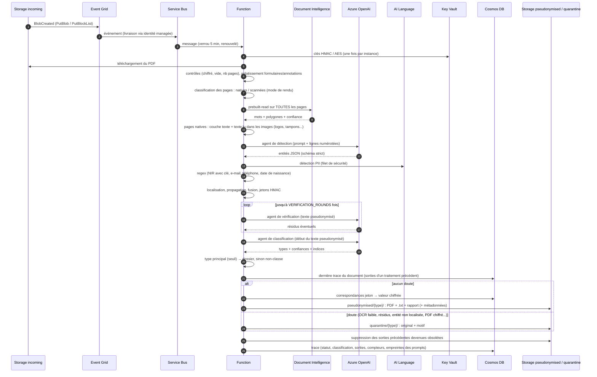
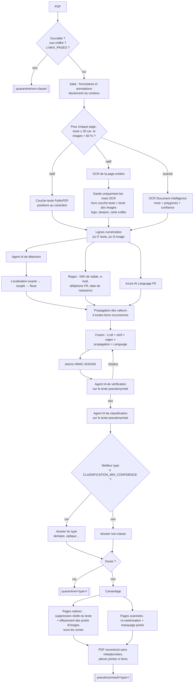

# Architecture

## Vue d'ensemble



Toutes les liaisons utilisent l'**identité managée** de la Function (RBAC Entra ID). Aucune
clé d'accès n'est utilisée : elles sont désactivées sur le stockage, Service Bus, Cosmos DB et
les services IA.

## Déroulé d'un traitement



## Pipeline détaillé



## Choix structurants

| Sujet | Choix | Raison |
|---|---|---|
| Déclenchement | Event Grid → **Service Bus** → Function | Retries, dead-letter, absorption des pics et rejeu. Un traitement dure de 10 à 120 s. |
| Calcul | **Functions Flex Consumption** (Python) | Paiement à l'usage, intégration VNet, identité managée. PyMuPDF s'installe par pip, sans conteneur. |
| PDF natifs | **PyMuPDF** : extraction des mots et `apply_redactions` | Le texte est réellement supprimé du PDF, pas seulement recouvert. |
| OCR | **Document Intelligence `prebuilt-read` sur toutes les pages** | Une page native peut contenir des images porteuses de données personnelles (logo d'un praticien ou d'un artisan, tampon, signature, carte collée). L'OCR est robuste aux scans de mauvaise qualité et renvoie un polygone et une confiance par mot. |
| Pages natives | Couche texte **+** texte OCR des images | Le texte natif reste la source principale, car il est exact et caviardable au caractère près. Seuls les mots OCR qui ne recouvrent aucun mot natif sont ajoutés, ce qui évite les doublons. |
| Détection | **Agent LLM** piloté par un prompt + **regex** + **AI Language** | Le LLM comprend le contexte (qui est une personne, quelle date est une date de naissance). Les filets déterministes sécurisent le rappel. |
| Contrôle | **Second agent LLM** (vérificateur) | Relit le résultat pseudonymisé et repère les oublis et les fragments résiduels. |
| Jetons | `HMAC-SHA256(clé, type + valeur normalisée)` | Une même personne reçoit le même jeton dans tous les documents. Le jeton n'est pas réversible sans la table. |
| Ré-identification | Valeur chiffrée **AES-256-GCM** dans Cosmos DB, avec le jeton en données associées | La table est séparée des documents et son accès est restreint et tracé (journal d'audit Key Vault). |
| Doute | **Quarantaine** plutôt que publication | Un faux négatif (fuite) coûte bien plus cher qu'un traitement manuel. |
| Type de document | **Agent LLM de classification** piloté par `types-documents.md`, appliqué au texte **pseudonymisé** | Pas besoin des données personnelles pour reconnaître une facture dentaire (minimisation RGPD). Un type s'ajoute sans redéployer. Les alternatives (mots-clés, classifieur entraîné Document Intelligence) sont moins robustes ou demandent des documents réels pour l'entraînement. |
| Rangement | Sous-dossier par type dans `pseudonymised/` **et** `quarantine/` ; métadonnées de blob ; classification complète dans le rapport et la trace Cosmos DB | Consultation simple par dossier, filtrage par programme via les métadonnées, statistiques via Cosmos DB. |
| Prompts | Stockés dans un Blob versionné, rechargés à chaud (ETag) | Un expert métier peut les faire évoluer sans redéployer le code. |
| Résidence | OpenAI en déploiement **DataZoneStandard** (UE), autres services en France Central | Conformité RGPD. |

## Classification du type de document

L'agent de classification lit le **début du texte déjà pseudonymisé** (`CLASSIFICATION_MAX_CHARS`,
6 000 caractères par défaut). Il renvoie une **liste de types**, chacun avec une confiance
**indépendante** entre 0 et 1 et quelques indices métier. Les confiances ne totalisent pas
forcément 1 : une facture de centre de santé peut être à la fois DENTAIRE à 0,85 et OPTIQUE à 0,85.

| Notion | Règle |
|---|---|
| **Type principal** | Le type de plus forte confiance, s'il atteint `CLASSIFICATION_MIN_CONFIDENCE` (0,6) et dépasse la confiance donnée à `NON_CLASSE`. C'est lui qui détermine le dossier. |
| **Types secondaires** | Les autres types au-dessus de `CLASSIFICATION_SECONDARY_MIN_CONFIDENCE` (0,3). Ils sont conservés dans le rapport, la trace et les métadonnées, mais ne déterminent pas le dossier. |
| **`multi_type`** | Vrai si au moins deux types atteignent le seuil principal (document mixte). Le fichier n'est **pas** copié dans plusieurs dossiers. |
| **`NON_CLASSE`** | Aucun type au-dessus du seuil, réponse « non classable » de l'agent ou erreur d'appel. Le document va dans `non-classe/` (`UNCLASSIFIED_FOLDER`), **sans** quarantaine : une erreur de classement n'expose aucune donnée. |

| Statut (`classification.statut`) | Signification |
|---|---|
| `ok` | Un type principal a été retenu. |
| `non_classe` | L'agent a répondu, mais aucun type n'atteint le seuil. |
| `erreur` | L'appel à l'agent a échoué. La pseudonymisation n'est pas bloquée. |
| `non_applicable` | Document rejeté avant extraction (illisible, chiffré, trop volumineux) : dossier `non-classe`. |
| `desactivee` | `CLASSIFICATION_ENABLED=false` : sorties à la racine des containers, sans sous-dossier. |

Arborescence produite, avec le chemin d'origine conservé sous le dossier du type :

```
pseudonymised/
├── dentaire/       <chemin>.pdf · <chemin>.pseudonymise.txt · <chemin>.rapport.json
├── optique/
├── kinesitherapie/
├── psychologie/
└── non-classe/
quarantine/
├── dentaire/       <chemin>.pdf (original) · <chemin>.pdf.motif.json
├── …
└── non-classe/     PDF illisibles, chiffrés, trop volumineux, ou de type indéterminé
```

La classification est conservée à trois endroits :
- dans le **rapport** ou le **motif** JSON (version complète) ;
- dans la **trace Cosmos DB** (version complète, plus la liste des sorties écrites) ;
- dans les **métadonnées de blob** : `document_type`, `document_types`
  (`DENTAIRE:0.92;OPTIQUE:0.35`) et `classification_statut`.

**Retraitement** : si un document est redéposé et classé différemment, ou s'il passe de la
quarantaine à la publication (ou l'inverse), les sorties du traitement précédent sont
retrouvées grâce à la trace Cosmos DB et **supprimées**. Il n'en reste donc jamais deux
versions dans deux dossiers.

## Sécurité

- **Identités** : une identité managée affectée par l'utilisateur pour la Function, avec des
  rôles au plus juste (lecture seule sur `config`, contributeur sur les seuls containers utiles).
  Event Grid a sa propre identité (envoi vers la file uniquement).
- **Secrets** : uniquement les deux clés dans Key Vault (RBAC, purge protection, audit dans
  Log Analytics). Il n'y a aucune chaîne de connexion.
- **Réseau** (option `enable_private_networking`) : VNet, intégration VNet de la Function,
  private endpoints et zones DNS privées pour tous les services, accès publics fermés.
  Service Bus passe alors en Premium.
- **Journaux** : seuls des identifiants pseudonymes (`doc=<sha256 tronqué>`), des compteurs et
  des statuts sont journalisés, **jamais** de texte extrait ni de valeur détectée.
- **Données en transit chez les LLM** : Azure OpenAI ne conserve pas les prompts pour
  l'entraînement. Pour des données de santé, envisager la demande d'exemption de l'abuse
  monitoring (modified abuse monitoring) auprès de Microsoft.

## Limites connues (phase 1)

- Le masquage des pages scannées se fait au niveau du mot OCR : un mot partiellement
  concerné est masqué en entier.
- Sur une page native, le texte des images (logos, tampons, cartes collées) est lu par OCR et
  caviardé dans les pixels. En revanche, un logo **vectoriel** (dessiné en tracés, sans image) dont
  les tracés ne sont pas entièrement contenus dans la zone peut laisser des contours sous le
  masque gris. `FORCE_OCR=true` rastérise toutes les pages si l'on veut une garantie maximale.
- L'OCR ne lit que du **texte** : un visage sur une photo ou une signature manuscrite illisible
  ne sont pas détectés.
- Coût : chaque page est facturée par Document Intelligence (`prebuilt-read`), qu'elle soit
  native ou scannée. `OCR_NATIVE_PAGES=false` désactive l'OCR des pages natives, au prix de
  la perte de détection dans les images.
- Un jeton long dans une zone étroite (prénom court) s'affiche en petits caractères. Le
  fichier `.pseudonymise.txt` contient toujours les jetons complets.
- Un PDF protégé par mot de passe part en quarantaine.
- Les confiances de classification sont **estimées par le modèle**, ce ne sont pas des
  probabilités calibrées. Les seuils (0,6 / 0,3) sont à ajuster sur un échantillon de vrais
  documents.
- La classification ne lit que le début du document (6 000 caractères) : un document très long
  dont la nature n'apparaît qu'à la fin peut être mal classé.

## Évolutions

**Phase 2 : photos de smartphone.**
- Ajouter un prétraitement : rotation EXIF, conversion HEIC, correction de perspective,
  CLAHE et débruitage avec OpenCV.
- Faire passer ces fichiers par le même chemin que les pages scannées : OCR Document
  Intelligence puis rastérisation et masquage.
- Ajouter un repli vers un modèle vision quand la confiance OCR est faible.
- Le filtre Event Grid (`subject_ends_with = ".pdf"`) et `handler.py` sont les deux seuls
  points d'entrée à étendre.

**Autres pistes :**
- Une interface de revue de la quarantaine.
- Un jeu d'évaluation annoté, avec mesure automatique du rappel à chaque modification
  de prompt.
