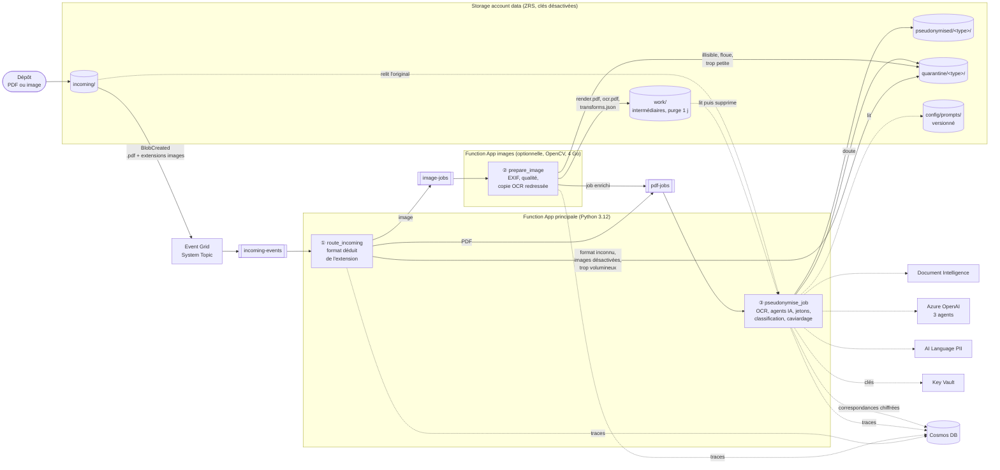
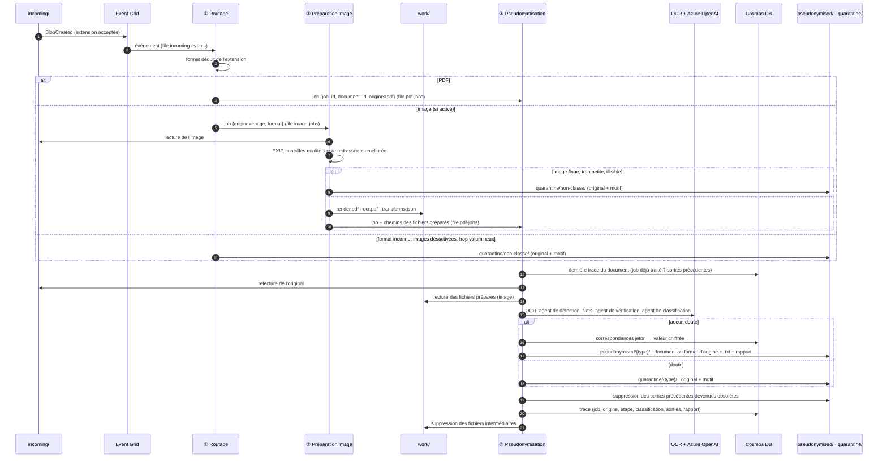
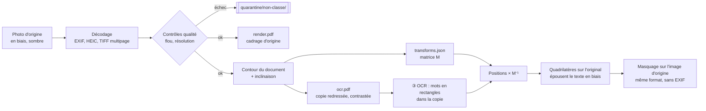
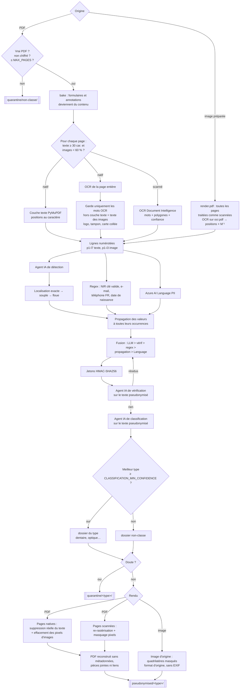
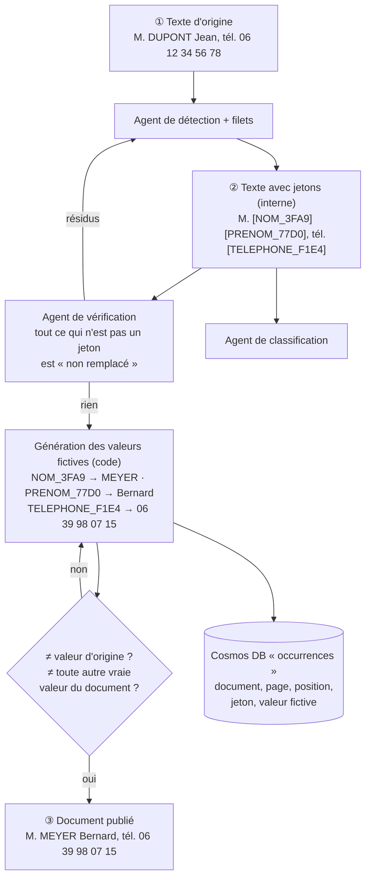

# Architecture

## Vue d'ensemble

Le traitement est découpé en **trois étapes**, reliées par des **files Service Bus**. Le
document déposé ne bouge jamais : il reste dans `incoming/`. Seuls des messages (« jobs »)
passent d'une étape à l'autre.



La correspondance entre ces briques et les ressources visibles dans le portail Azure (noms,
types, conditions de création) est détaillée dans l'[inventaire des ressources](deploiement.md#ressources-déployées).
En particulier, « AI Language PII » désigne la ressource **Language** (`lang-…`) : la détection
PII est une fonctionnalité de ce service.

Toutes les liaisons utilisent des **identités managées** (RBAC Entra ID), une par Function App.
Aucune clé d'accès n'est utilisée : elles sont désactivées sur le stockage, Service Bus,
Cosmos DB et les services IA.

| Étape | Function App | Déclencheur | Rôle |
|---|---|---|---|
| ① Routage | principale (`functions_main.py`) | `incoming-events` (Event Grid) | Déduit le format **uniquement de l'extension** et envoie un job vers `pdf-jobs` ou `image-jobs`. Les extensions non prises en charge, les images quand leur traitement est désactivé et les fichiers trop volumineux vont en `quarantine/non-classe/`. |
| ② Préparation des images | images (`functions_images.py`) | `image-jobs` | Décode l'image, la contrôle, prépare une copie redressée pour l'OCR et l'emballe en PDF dans `work/<job>/`. Transmet ensuite le job à `pdf-jobs`. |
| ③ Pseudonymisation | principale (`functions_main.py`) | `pdf-jobs` | Traite un PDF d'origine ou une image préparée : OCR, agents IA, jetons, classification et caviardage. La sortie est produite au **format d'origine**. |

## Déroulé d'un traitement



## Messages entre étapes (jobs)

Un job est un message JSON ([src/pseudo/jobs.py](../src/pseudo/jobs.py)). Il transporte tout le
contexte du document, ce qui permet de suivre son fil de bout en bout :

```jsonc
{
  "job_id": "5f0c…",                       // identifiant de corrélation, attribué par le routeur
  "document_id": "a91be2c4…",              // empreinte stable du chemin dans incoming/ (traces, retraitements)
  "source_container": "incoming",
  "source_name": "lot1/photo-facture.jpg",
  "source_format": "jpeg",                 // déduit de l'extension : pdf, jpeg, png, tiff, webp, bmp, heif
  "origin": "image",                       // pdf | image
  "received_at": "2026-10-11T14:02:11Z",
  "prepared": {                            // uniquement pour une image préparée
    "render_pdf": "5f0c…/render.pdf",
    "ocr_pdf": "5f0c…/ocr.pdf",
    "transforms": "5f0c…/transforms.json",
    "preparation": {"format": "jpeg", "orientation_exif": 6, "pages": 1, "pages_detail": [ … ]}
  }
}
```

- **Idempotence** : Event Grid et Service Bus livrent « au moins une fois ». Si un job déjà
  terminé est relivré, l'étape 3 le reconnaît, parce que la dernière trace porte le même `job_id`,
  et l'ignore. Chaque écriture se fait avec `overwrite`, ce qui la rend rejouable.
- **Échecs** : une exception remet le message dans sa file, puis en **dead-letter** après
  `servicebus_max_delivery_count` tentatives. Chaque file a sa propre dead-letter.
- **Données personnelles** : un job ne contient que des chemins et des métadonnées techniques,
  jamais le contenu du document. Le nom de fichier peut contenir un nom de personne : seul le
  `document_id` apparaît dans les journaux.

## Préparation des images (étape ②)

Pour une image, l'étape ② produit **trois fichiers** dans `work/<job_id>/` :

| Fichier | Contenu | Utilisé pour |
|---|---|---|
| `render.pdf` | L'image **d'origine** : orientation EXIF appliquée, **cadrage conservé** (table, biais, ombres), une page par image (TIFF multipage). | Analyse du document et taille des pages. La sortie est dessinée sur l'image d'origine elle-même. |
| `ocr.pdf` | Une copie **redressée** (perspective, inclinaison) et **améliorée** (débruitage, contraste local). Elle n'est jamais publiée. | Lecture par Document Intelligence uniquement. |
| `transforms.json` | Pour chaque page : dimensions, résolution et **matrice 3×3 « original → copie OCR »**. | Report sur l'original de la position des mots lus dans la copie. |



**Pourquoi deux versions ?** Une décision fonctionnelle impose de garder le cadrage d'origine en
sortie, pour que les documents pseudonymisés restent réutilisables comme jeux de test avec
leurs défauts. Mais l'OCR lit bien mieux un texte droit et contrasté. La copie OCR sert donc
uniquement à lire, et la matrice permet de reporter chaque mot sur la photo d'origine. Un mot
lu dans un rectangle de la copie devient un **quadrilatère penché** sur l'original : le masque
épouse le mot sans déborder sur ses voisins.

| Traitement | Détail | Réglage |
|---|---|---|
| Décodage | JPEG, PNG, TIFF multipage, WebP, BMP, HEIF/HEIC, **uniquement dans le format annoncé par l'extension** (sinon `image_illisible`). Les images au-delà de la limite sont refusées. | `IMAGE_MAX_PIXELS` (50 Mpx) |
| Orientation | Orientation EXIF appliquée (première cause des photos « à l'envers »). | — |
| Qualité | Côté court trop petit → `image_resolution_insuffisante`. Flou (variance du laplacien) → `image_floue`. Dans les deux cas, **quarantaine**. | `IMAGE_MIN_SHORT_SIDE` (1000 px), `IMAGE_BLUR_THRESHOLD` (60) |
| Perspective | Plus grand quadrilatère convexe couvrant au moins 25 % de l'image, ramené à un rectangle. Ignorée si le document remplit le cadre. | `IMAGE_ENHANCE_FOR_OCR` |
| Inclinaison | Angle qui maximise la netteté des lignes de texte, entre −10° et +10°. | `IMAGE_ENHANCE_FOR_OCR` |
| Amélioration | Niveaux de gris, débruitage, contraste local (CLAHE), sur la copie OCR uniquement. | `IMAGE_ENHANCE_FOR_OCR` |
| Sortie | Même format que l'entrée, **sans EXIF** (ni GPS, ni modèle d'appareil). Un seul jeton par zone masquée. | `IMAGE_OUTPUT_QUALITY` (90) |

Avec `IMAGE_ENHANCE_FOR_OCR=false`, aucune copie n'est produite : l'OCR lit directement
`render.pdf`, et les masques suivent les polygones renvoyés par l'OCR.

## Pipeline de pseudonymisation (étape ③)

Le pipeline ([src/pseudo/pipeline.py](../src/pseudo/pipeline.py)) ne connaît que des PDF. Une
image lui arrive déjà emballée par l'étape ②, avec deux pièces propres aux images
([src/pseudo/prepared_image.py](../src/pseudo/prepared_image.py)) :
- **son OCR** : la copie redressée, avec les positions reportées sur l'original ;
- **son rendu** : le masquage se fait sur l'image d'origine.



## Valeurs fictives (mode substitution)

Le contenu publié dépend de `PSEUDO_OUTPUT_MODE` (variable Terraform `pseudo_output_mode`) :

| Mode | Document publié | Usage |
|---|---|---|
| `substitution` (défaut) | `Patient : M. MEYER Bernard, tél. 06 39 98 07 15` | Documents réalistes, lisibles par un OCR, réutilisables comme jeux de test. |
| `jetons` | `Patient : M. [NOM_3FA9…] [PRENOM_77D0…], tél. [TELEPHONE_F1E4…]` | Relecture humaine ou audit : on voit immédiatement ce qui a été remplacé. |

**Les jetons restent utilisés en interne dans les deux modes.** L'agent de vérification doit
distinguer ce qui a été remplacé de ce qui ne l'a pas été. Avec des valeurs réalistes, un faux
nom ressemblerait à un vrai nom oublié. Les valeurs fictives ne sont donc posées qu'**après** la
vérification et la classification, juste avant le rendu du document :



**Génération** ([src/pseudo/surrogates/](../src/pseudo/surrogates/)) : par du **code**, pas par l'IA,
à partir de listes génériques ([data/](../src/pseudo/surrogates/data/)). Chaque champ indique son
générateur dans le référentiel (`**Substitution** : …`, voir [prompts.md](prompts.md#modifier-les-règles)).

| Générateur | Valeur produite |
|---|---|
| `nom`, `prenom`, `personne` | Noms et prénoms courants. Le genre du prénom est conservé (prénom connu, ou civilité `M.`/`Mme` qui précède). Initiale (`J.`), prénom composé et casse sont respectés. |
| `date_naissance` | Date **au hasard** (1925 à l'an dernier), au format de l'original (`12/03/1985`, `8 septembre 1975`, `1985-03-12`…). |
| `nir` | NIR fictif à **clé valide**. Le chiffre du sexe est conservé. **L'année et le mois correspondent à la date de naissance fictive.** Le département et la commune sont tirés au hasard. La mise en forme (espaces) est conservée. |
| `telephone` | Numéro dans les **tranches réservées à la fiction par l'ARCEP** (`06 39 98 …`, `04 65 71 …`), au format d'origine (`+33`, points, espaces). |
| `email` | `prenom.nom@example.com` (domaine réservé). |
| `adresse` | Numéro et nom de voie fictifs, **vrai couple code postal / ville**. Les mots de structure (`rue`, `Bât.`, `Apt`…) sont conservés. Une adresse sur plusieurs lignes est remplacée fragment par fragment. |
| `generique` | Même forme que l'original : lettres → lettres (même casse), chiffres → chiffres. Pour un champ sans générateur dédié. |

- **Déterministe** : le tirage est calculé par HMAC avec la clé de Key Vault déjà utilisée pour
  les jetons. Une même valeur d'origine reçoit **la même valeur fictive dans tous les documents**,
  et la valeur fictive ne permet pas de remonter à l'original sans la clé.
- **Date de naissance ↔ NIR** : le faux « année + mois » est calculé à partir du vrai
  « année (2 chiffres) + mois », de la même façon pour les deux champs. La date fictive et le NIR
  fictif d'une même personne concordent donc toujours, même dans des documents différents.
- **Jamais une vraie valeur** : la valeur fictive doit différer, après normalisation, de la
  valeur d'origine et de toutes les autres valeurs d'origine du document. Sinon un nouveau tirage
  est fait. Ce contrôle est fait par le code, pas par un agent IA : il est certain et gratuit.

**Rendu**

| Support | Rendu en mode substitution |
|---|---|
| PDF, texte natif | Le texte d'origine est **supprimé** (caviardage), puis la valeur fictive est écrite avec la **taille, la ligne de base et la graisse** du texte d'origine, sur la couleur du fond. Elle peut déborder jusqu'au mot suivant avant d'être réduite. |
| PDF, page scannée ou texte d'une image | Pixels effacés avec la couleur du fond environnant, valeur fictive écrite en noir. |
| Image (photo, scan) | Même principe, sur l'image d'origine. La zone suit le quadrilatère du mot sur une photo prise de biais. |

**Ce qui est conservé pour revenir à l'original** :

| Où | Contenu |
|---|---|
| Key Vault | Inchangé : la clé HMAC (jetons, valeurs fictives) et la clé AES (chiffrement). |
| Cosmos DB `mappings` | Inchangé : jeton → valeur d'origine **chiffrée**. |
| Cosmos DB `occurrences` (partitionné par document) | Une fiche par zone remplacée dans un document publié : chemin publié et d'origine, page, position (points, et pixels pour une image), type, jeton, valeur fictive. **Aucune valeur d'origine.** Les fiches sont remplacées à chaque retraitement du document. Elles sont écrites dans les deux modes. |

Ré-identification : document + valeur fictive (ou page, position) → `occurrences` → jeton →
`mappings` → déchiffrement avec la clé AES. On part toujours **du document** : les listes de faux
noms étant limitées, deux personnes différentes peuvent recevoir le même faux nom. Le script
[reidentify.py](../src/reidentify.py) fait cette résolution (voir [exploitation](exploitation.md#ré-identification)).

## Organisation du code

| Module | Rôle | Utilisé par |
|---|---|---|
| `formats.py` | Format déduit de l'extension, types MIME | ①, CLI |
| `jobs.py`, `events.py` | Messages entre étapes, lecture des événements Event Grid | ①②③ |
| `router.py` | Étape ① : routage | app principale |
| `images/` (`prepare.py`, `preprocess.py`, `quality.py`) | Étape ② : préparation des images. **Seul code qui dépend d'OpenCV.** | app images, CLI |
| `image_codec.py` | Décodage et encodage des images (Pillow, pillow-heif), sans EXIF en sortie | ②③ |
| `surrogates/` | Générateurs de valeurs fictives (mode substitution) et leurs listes de données | ③ |
| `geometry.py` | Homographies en Python pur, géométrie des pages préparées | ②③ |
| `prepared_image.py` | Entrée « image préparée » de l'étape ③ : OCR transformé, rendu sur l'image d'origine | ③ |
| `handler.py` | Étape ③ : chargement du job, pipeline, publication | app principale |
| `pipeline.py` | Pipeline de pseudonymisation, indépendant du format (`PipelineInput`) | ③, CLI |
| `outputs.py` | Écriture des sorties et de la quarantaine, métadonnées, traces, nettoyages | ①②③ |
| `extraction.py`, `spans.py`, `redaction.py`, `detection/`, `pseudonymizer.py`, `classification.py`… | Cœur du traitement (PDF) | ③ |

Les deux Function Apps sont déployées **à partir du même code source**. L'app images utilise
le même point d'entrée `function_app.py`. Le paramètre d'application `FUNCTION_APP_ROLE`, posé par
Terraform (`main` ou `images`), décide quelles fonctions il enregistre, grâce au mécanisme officiel
des *blueprints* : `functions_main.py` pour l'app principale, `functions_images.py` pour l'app
images. L'app images reçoit en plus les
dépendances de `requirements-images.txt` (OpenCV, NumPy). L'app principale n'installe pas OpenCV.

## Choix structurants

| Sujet | Choix | Raison |
|---|---|---|
| Enchaînement | **Étapes reliées par des messages** (files Service Bus), document immobile dans `incoming/` | Chaque étape est isolée : dépendances, mémoire, montée en charge, retries et dead-letter propres. On évite les déplacements de blobs, qui ne sont pas atomiques et multiplient les copies de données personnelles. Le fil d'un document est conservé (`job_id`). |
| Routage | Par **extension uniquement**, sans inspecter le contenu | Simple et prévisible. Chaque lecteur n'accepte ensuite que le format annoncé : un contenu non conforme (image renommée en `.pdf`, PNG renommé en `.jpg`) n'est **jamais réinterprété** et part en quarantaine, car ce peut être une tentative de contournement. |
| Images | **Function App dédiée** (optionnelle, `enable_image_processing`) | OpenCV et 4 Go de mémoire uniquement là où c'est utile. Activation et désactivation par Terraform. |
| Sortie image | **Format et cadrage d'origine**, sans EXIF | Choix fonctionnel : sorties réutilisables comme jeux de test. Les métadonnées EXIF (GPS, appareil) sont des données personnelles. |
| OCR des images | Sur une **copie redressée**, positions reportées sur l'original (homographie) | Meilleure lecture des photos de biais ou sombres, et masques ajustés aux mots. |
| Image floue ou trop petite | **Quarantaine** | Un OCR raté laisserait passer des noms. |
| Calcul | **Functions Flex Consumption** (Python) | Paiement à l'usage, intégration VNet, identité managée, sans conteneur. |
| PDF natifs | **PyMuPDF** : extraction des mots et `apply_redactions` | Le texte est réellement supprimé du PDF, pas seulement recouvert. |
| OCR | **Document Intelligence `prebuilt-read` sur toutes les pages** | Les images incrustées (logo, tampon, carte collée) peuvent contenir des données personnelles. L'OCR renvoie un polygone et une confiance par mot. |
| Pages natives | Couche texte **+** texte OCR des images | Le texte natif reste exact et caviardable au caractère près. Seuls les mots OCR hors couche texte sont ajoutés. |
| Détection | **Agent LLM** piloté par un prompt + **regex** + **AI Language** | Le LLM comprend le contexte ; les filets déterministes sécurisent le rappel. |
| Contrôle | **Second agent LLM** (vérificateur) | Repère les oublis et les fragments résiduels. |
| Jetons | `HMAC-SHA256(clé, type + valeur normalisée)` | Une même personne reçoit le même jeton dans tous les documents. Le jeton n'est pas réversible sans la table. Les jetons restent l'étiquette interne de chaque valeur remplacée, même en mode substitution. |
| Document publié | **Valeurs fictives réalistes** par défaut (`substitution`), jetons en option | Documents lisibles par un OCR et réutilisables en test. Valeurs fabriquées par du code (déterministes, sûres, au format d'origine), posées après la vérification pour ne pas tromper l'agent vérificateur. |
| Ré-identification | Valeur chiffrée **AES-256-GCM** dans Cosmos DB (`mappings`) + emplacement de chaque remplacement (`occurrences`) | Table séparée des documents, accès restreint et tracé (audit Key Vault). Retour à l'original par document et position, sans rien cacher dans les fichiers publiés. |
| Doute | **Quarantaine** plutôt que publication | Un faux négatif (fuite) coûte bien plus cher qu'un traitement manuel. |
| Type de document | **Agent LLM de classification** piloté par `types-documents.md`, appliqué au texte **pseudonymisé** | Minimisation RGPD. Un type s'ajoute sans redéployer. |
| Rangement | Sous-dossier par type dans `pseudonymised/` **et** `quarantine/`, métadonnées de blob, classification dans le rapport et la trace | Consultation par dossier, filtrage par programme, statistiques via Cosmos DB. |
| Prompts | Stockés dans un Blob versionné, rechargés à chaud (ETag) | Un expert métier peut les faire évoluer sans redéployer. |
| Résidence | OpenAI en **DataZoneStandard** (UE), autres services en France Central | Conformité RGPD. |

## Classification du type de document

L'agent de classification lit le **début du texte déjà pseudonymisé** (`CLASSIFICATION_MAX_CHARS`,
6 000 caractères par défaut). Le traitement est le même pour un PDF et pour une image. L'agent
renvoie une **liste de types**, chacun avec une confiance **indépendante** entre 0 et 1 et
quelques indices métier. Les confiances ne totalisent pas forcément 1 : une facture de centre
de santé peut être à la fois DENTAIRE à 0,85 et OPTIQUE à 0,85.

| Notion | Règle |
|---|---|
| **Type principal** | Le type de plus forte confiance, s'il atteint `CLASSIFICATION_MIN_CONFIDENCE` (0,6) et dépasse la confiance donnée à `NON_CLASSE`. C'est lui qui détermine le dossier. |
| **Types secondaires** | Les autres types au-dessus de `CLASSIFICATION_SECONDARY_MIN_CONFIDENCE` (0,3). Ils sont conservés dans le rapport, la trace et les métadonnées, mais ne déterminent pas le dossier. |
| **`multi_type`** | Vrai si au moins deux types atteignent le seuil principal (document mixte). Le fichier n'est **pas** copié dans plusieurs dossiers. |
| **`NON_CLASSE`** | Aucun type au-dessus du seuil, réponse « non classable » de l'agent ou erreur d'appel. Le document va dans `non-classe/` (`UNCLASSIFIED_FOLDER`), **sans** quarantaine. |

| Statut (`classification.statut`) | Signification |
|---|---|
| `ok` | Un type principal a été retenu. |
| `non_classe` | L'agent a répondu, mais aucun type n'atteint le seuil. |
| `erreur` | L'appel à l'agent a échoué. La pseudonymisation n'est pas bloquée. |
| `non_applicable` | Document rejeté avant l'étape ③ (format inconnu, illisible, chiffré, trop volumineux, image floue…) : dossier `non-classe`. |
| `desactivee` | `CLASSIFICATION_ENABLED=false` : sorties à la racine des containers, sans sous-dossier. |

Arborescence produite, avec le chemin d'origine conservé sous le dossier du type et le
document au **format d'origine** :

```
pseudonymised/
├── dentaire/       <chemin>.pdf|.jpg|… · <chemin>.pseudonymise.txt · <chemin>.rapport.json
├── optique/
├── kinesitherapie/
├── psychologie/
└── non-classe/
quarantine/
├── dentaire/       <chemin>.<ext> (original) · <chemin>.<ext>.motif.json
├── …
└── non-classe/     formats inconnus, PDF illisibles ou chiffrés, images floues, trop volumineux…
```

La classification est conservée à trois endroits :
- dans le **rapport** ou le **motif** JSON (version complète) ;
- dans la **trace Cosmos DB** (version complète, plus la liste des sorties écrites) ;
- dans les **métadonnées de blob** : `document_type`, `document_types`
  (`DENTAIRE:0.92;OPTIQUE:0.35`) et `classification_statut`.

**Retraitement** : si un document est redéposé dans `incoming/` au même chemin et classé
différemment, ou s'il passe de la quarantaine à la publication (ou l'inverse), les sorties du
traitement précédent sont retrouvées grâce à la trace Cosmos DB et **supprimées**.

## Sécurité

- **Contenu non conforme à l'extension** : un fichier `.pdf` dont le contenu n'est pas un PDF
  part en quarantaine avec `pdf_illisible`. Le contrôle est explicite, car MuPDF ouvrirait sinon
  une image renommée. Une image dont le contenu ne correspond pas à son extension part en
  quarantaine avec `image_illisible`. Aucun format n'est « deviné » à partir du contenu.
- **Identités** : une identité managée par Function App, avec des rôles au plus juste.
  - L'app principale lit `incoming/`, `work/` et `config/` (lecture seule), écrit `pseudonymised/`
    et `quarantine/`, reçoit `incoming-events` et `pdf-jobs`, envoie vers `pdf-jobs` et `image-jobs`.
  - L'app images lit `incoming/`, écrit `work/` et `quarantine/`, reçoit `image-jobs` et envoie vers
    `pdf-jobs`. Elle n'a **aucun accès** à Azure OpenAI, Document Intelligence ni Key Vault.
  - Event Grid a sa propre identité, qui ne peut qu'envoyer vers `incoming-events`.
- **Fichiers intermédiaires** : `work/<job>/` contient des copies du document. Ils sont supprimés
  dès la fin du traitement, et purgés automatiquement après `work_retention_days` (1 jour) en
  cas d'interruption.
- **Métadonnées des images** : les sorties sont réencodées depuis les pixels, sans EXIF (ni GPS,
  ni modèle d'appareil, ni date de prise de vue).
- **Secrets** : uniquement les deux clés dans Key Vault (RBAC, purge protection, audit dans
  Log Analytics). Il n'y a aucune chaîne de connexion.
- **Réseau** (option `enable_private_networking`) : VNet, intégration VNet des deux apps (un
  sous-réseau chacune), private endpoints et zones DNS privées pour tous les services, accès
  publics fermés. Service Bus passe alors en Premium.
- **Journaux** : seuls des identifiants pseudonymes (`doc=<sha256 tronqué>`, `job=<uuid>`), des
  compteurs et des statuts sont journalisés, **jamais** de texte extrait, de valeur détectée ni
  de nom de fichier.
- **Données en transit chez les LLM** : Azure OpenAI ne conserve pas les prompts pour
  l'entraînement. Pour des données de santé, envisager la demande d'exemption de l'abuse
  monitoring (modified abuse monitoring) auprès de Microsoft.

## Limites connues

**PDF**
- Le masquage des pages scannées se fait au niveau du mot OCR : un mot partiellement concerné
  est masqué en entier.
- Un logo **vectoriel** (dessiné en tracés, sans image) dont les tracés débordent de la zone
  peut laisser des contours sous le masque gris. `FORCE_OCR=true` rastérise toutes les pages si
  l'on veut une garantie maximale.
- Un PDF protégé par mot de passe part en quarantaine.

**Images**
- Une photo tournée de 90° ou 180° **sans** information EXIF est correctement lue et masquée,
  mais la sortie garde son orientation (pas de redressement automatique).
- La transparence (PNG, WebP) est aplatie sur fond blanc. Seule la première image d'un WebP
  animé est traitée.
- Les jetons sont écrits horizontalement dans le masque, même sur un document photographié en biais.
- La détection du contour du document est heuristique. Sur un fond clair et peu contrasté, elle
  peut échouer : la copie OCR n'est alors pas redressée en perspective, mais l'inclinaison reste
  corrigée.

**Valeurs fictives**
- Le remplacement reste visible à l'œil sur une photo ou un scan : le fond est reproduit par sa
  couleur dominante, sans sa texture, et la police n'est pas celle d'origine. Il est lisible par
  un OCR.
- La mise en page n'est jamais décalée : une valeur fictive plus courte laisse un blanc, une
  valeur plus longue déborde jusqu'au mot suivant puis est réduite.
- La date de naissance fictive est tirée sur une plage large. Elle peut rendre un document
  incohérent (un « enfant » de 70 ans), mais elle concorde toujours avec le NIR fictif.
- Les listes de noms sont limitées : deux personnes réelles différentes peuvent recevoir le même
  faux nom. C'est sans conséquence pour la ré-identification, qui passe par le document et la position.

**Commun**
- L'OCR ne lit que du **texte** : un visage sur une photo ou une signature manuscrite illisible
  ne sont pas détectés.
- Un jeton long dans une zone étroite (prénom court) s'affiche en petits caractères. Le fichier
  `.pseudonymise.txt` contient toujours les jetons complets.
- Les confiances de classification sont **estimées par le modèle**, ce ne sont pas des
  probabilités calibrées. Les seuils (0,6 / 0,3) sont à ajuster sur un échantillon de vrais
  documents.
- Coût : chaque page est facturée par Document Intelligence (`prebuilt-read`), qu'il s'agisse
  d'une page native, d'une page scannée ou d'une image.

## Évolutions

- **Repli vers un modèle vision** quand la confiance OCR d'une image est faible (aujourd'hui :
  quarantaine `ocr_faible_confiance`).
- **Redressement de l'orientation** d'une photo sans EXIF, à partir de l'angle renvoyé par l'OCR.
- **Interface de revue** de la quarantaine et des documents `non-classe`.
- **Jeu d'évaluation annoté**, avec mesure automatique du rappel à chaque modification de prompt,
  puis comparaison avec un classifieur plus léger (embeddings ou modèle BERT entraîné).
