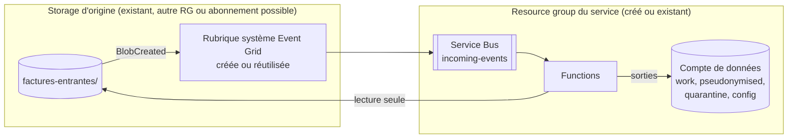

# Déploiement

## Prérequis

- Terraform ≥ 1.9, Azure CLI (`az login`), Azure Functions Core Tools v4 (`func`).
- Droits sur l'abonnement : **Contributor** et **User Access Administrator** (ou Owner),
  nécessaires pour créer les affectations de rôles.
- Quota Azure OpenAI pour le modèle choisi dans la région `openai_location`.
- Un compte de stockage pour l'état Terraform (`backend.hcl`).

> L'état Terraform contient les clés HMAC et AES générées. Stockez-le dans un backend chiffré
> à accès restreint, ou créez ces secrets hors Terraform (voir `infra/keyvault.tf`).

## Préparer l'abonnement (une seule fois)

**1. Enregistrer les fournisseurs de ressources.** Sans cela, l'apply échoue avec
`MissingSubscriptionRegistration` :

```powershell
foreach ($p in 'Microsoft.ManagedIdentity','Microsoft.App','Microsoft.Web','Microsoft.CognitiveServices','Microsoft.EventGrid','Microsoft.ServiceBus','Microsoft.DocumentDB','Microsoft.KeyVault','Microsoft.OperationalInsights','Microsoft.Insights','Microsoft.Storage','Microsoft.Network') { az provider register -n $p }
```

L'enregistrement prend quelques minutes. Les fournisseurs encore en cours d'enregistrement
s'affichent avec :

```powershell
az provider list --query "[?registrationState!='Registered' && contains('Microsoft.ManagedIdentity Microsoft.App Microsoft.Web Microsoft.CognitiveServices Microsoft.EventGrid Microsoft.ServiceBus Microsoft.DocumentDB Microsoft.KeyVault Microsoft.OperationalInsights Microsoft.Insights Microsoft.Storage Microsoft.Network', namespace)].{ns:namespace, etat:registrationState}" -o table
```

**2. Vérifier le quota Azure OpenAI** pour le modèle et le type de déploiement choisis.
Il faut une **limite au moins égale à `openai_capacity`** (en milliers de tokens/minute) :

```powershell
az cognitiveservices usage list -l swedencentral --query "[?contains(name.value, 'DataZoneStandard')].{quota:name.value, utilise:currentValue, limite:limit}" -o table
```

Si la limite est à 0 (`InsufficientQuota` à l'apply), trois solutions :
- **Demander du quota** : portail Azure AI Foundry, rubrique *Quotas*, ou le formulaire
  [aka.ms/oai/quotaincrease](https://aka.ms/oai/quotaincrease). C'est la bonne option pour des
  données personnelles.
- **Choisir un autre modèle** qui a déjà du quota en `DataZoneStandard` : modifier
  `openai_model_name` / `openai_model_version`. Le modèle doit prendre en charge les
  *Structured Outputs*.
- **Pour un test avec des données fictives uniquement** : `openai_deployment_sku = "GlobalStandard"`,
  dont le quota est souvent disponible par défaut. Les données peuvent alors être traitées hors
  de l'UE : à proscrire pour de vraies données personnelles.

Si le déploiement échoue malgré tout, réduire `openai_capacity` (par exemple à `10`) en
attendant le quota.

## Étapes

```powershell
copy infra/backend.hcl.example infra/backend.hcl
copy infra/terraform.tfvars.example infra/terraform.tfvars
# éditer les deux fichiers
./scripts/deploy.ps1          # terraform init/plan/apply + prompts + code
```

`deploy.ps1` enchaîne :
1. `terraform init`, `plan` puis `apply` (avec confirmation) ;
2. `publish-prompts.ps1` : copie de `prompts/*.md` vers `config/prompts/` ;
3. la publication de l'**app principale** (`func azure functionapp publish <app> --python`, avec
   build distant des dépendances) ;
4. si `enable_image_processing = true`, la publication de l'**app images**. Le même code source
   est copié dans un dossier temporaire, avec en plus les dépendances de
   `src/requirements-images.txt` (OpenCV, NumPy). Les deux apps partagent le point d'entrée
   `function_app.py`. Le paramètre `FUNCTION_APP_ROLE` (`main` ou `images`), posé par Terraform,
   décide des fonctions enregistrées.

Mises à jour partielles :

```powershell
./scripts/publish-prompts.ps1     # prompts seuls (pris en compte en moins de 5 min)
./scripts/deploy.ps1 -SkipInfra   # code + prompts
```

## Ressources déployées

Toutes les ressources sont créées dans le groupe **`rg-<projet>-<env>`**, ou dans le groupe choisi
avec `resource_group_name` (voir [Installer dans un resource group et sur un storage existants](#installer-dans-un-resource-group-et-sur-un-storage-existants)).
Les noms dépendent de
`project`, `environment` et d'un **suffixe aléatoire de 4 caractères**, tiré une fois pour toutes
pour garantir l'unicité des noms dans Azure.

Les exemples ci-dessous correspondent à `project = "pseudo"`, `environment = "dev"` et au suffixe
`mdg6`. Les noms réels sont affichés par `terraform -chdir=infra output`.

### Toujours déployées

| Ressource (type affiché dans le portail) | Nom (exemple) | Fichier Terraform | Rôle |
|---|---|---|---|
| Groupe de ressources | `rg-pseudo-dev` | `main.tf` | Contient toutes les ressources du service. Créé par Terraform, sauf avec `create_resource_group = false`. |
| Compte de stockage | `stpseudodevmdg6data` | `storage.tf` | Données : containers `incoming` (dépôt, sauf storage d'origine existant), `work` (intermédiaires des images), `pseudonymised`, `quarantine` (sorties) et `config` (prompts, versionnés). Règles de purge automatique. |
| Compte de stockage | `stpseudodevmdg6func` | `storage.tf` | Stockage interne des Function Apps : runtime et paquets de déploiement (`deployments`, `deployments-images`). |
| Espace de noms Service Bus | `sb-pseudo-dev-mdg6` | `messaging.tf` | Files `incoming-events`, `pdf-jobs`, `image-jobs` et `mail-jobs`, chacune avec sa dead-letter. Ce sont les liens entre les étapes. |
| Rubrique système Event Grid | `egst-pseudo-dev-data` | `messaging.tf` | Émet les événements « blob créé » du **storage d'origine** (le compte de données par défaut). L'abonnement `incoming-created-to-servicebus` les filtre (container d'entrée, extensions acceptées) et les envoie vers `incoming-events`. Avec un storage d'origine existant, elle est créée dans **son** resource group (`egst-pseudo-dev-source`), sauf si une rubrique existe déjà. |
| Plan App Service (Flex Consumption) | `asp-pseudo-dev` | `function.tf` (module `flex_function`) | Plan de l'app principale (un plan par app Flex). |
| Application de fonction | `func-pseudo-dev-mdg6` | `function.tf` (module `flex_function`) | **App principale** : étape ① routage (`route_incoming`) et étape ③ pseudonymisation (`pseudonymise_job`). |
| Identité managée | `id-pseudo-dev-func` | `main.tf` | Identité de l'app principale : tous ses accès (stockage, files, IA, Key Vault, Cosmos DB) passent par elle. |
| **Azure OpenAI** | `oai-pseudo-dev-mdg6` | `ai.tf` | Modèle des **trois agents IA** : détection, vérification, classification. Déploiement `pseudo-llm` (modèle `openai_model_name`). Région `openai_location`. |
| **Document Intelligence** | `di-pseudo-dev-mdg6` | `ai.tf` | **OCR** (`prebuilt-read`) des pages de PDF et des images. |
| Coffre de clés (Key Vault) | `kv-pseudodevmdg6` | `keyvault.tf` | Secrets `pseudo-hmac-key` (calcul des jetons) et `pseudo-encryption-key` (chiffrement des valeurs d'origine). Journal d'audit des accès. |
| Compte Azure Cosmos DB (serverless) | `cosmos-pseudo-dev-mdg6` | `cosmos.tf` | Base `pseudonymisation` : containers `mappings` (jeton → valeur d'origine chiffrée), `occurrences` (emplacement de chaque valeur remplacée dans les documents publiés : document, page, position, jeton, valeur fictive) et `traces` (historique des traitements, expiration après 1 an). |
| Espace de travail Log Analytics | `log-pseudo-dev` | `main.tf` | Journaux : télémétrie des Functions, audit Key Vault. |
| Application Insights | `appi-pseudo-dev` | `main.tf` | Supervision des deux Function Apps (journaux, exceptions, performances). |

### Selon la configuration

| Ressource (type affiché dans le portail) | Nom (exemple) | Condition | Rôle |
|---|---|---|---|
| **Language** (Azure AI Language) | `lang-pseudo-dev-mdg6` | `enable_language_pii = true` (défaut) | **Détection PII d'Azure** (« reconnaissance d'entités PII ») : filet de sécurité en complément de l'agent de détection. Dans le portail, il n'existe pas de ressource nommée « PII » : c'est une fonctionnalité de ce service Language (type technique `TextAnalytics`). |
| Plan App Service (Flex Consumption) | `asp-pseudo-dev-img` | `enable_image_processing = true` | Plan de l'app images. |
| Application de fonction | `func-pseudo-dev-mdg6-img` | `enable_image_processing = true` | **App images** : étape ② préparation des images (`prepare_image`), avec OpenCV. |
| Identité managée | `id-pseudo-dev-func-img` | `enable_image_processing = true` | Identité de l'app images (stockage, files, traces ; aucun accès aux services IA ni au Key Vault). |
| Réseau virtuel | `vnet-pseudo-dev` | `enable_private_networking = true` | Sous-réseaux `snet-func`, `snet-pe` et, avec les images, `snet-func-img`. |
| Points de terminaison privés | `pe-pseudo-dev-<service>` | `enable_private_networking = true` | Un par service : `data-blob`, `func-blob`, `func-queue`, `func-table`, `kv`, `openai`, `docintel`, `language`, `sb`, `cosmos`. |
| Zones DNS privées | `privatelink.*` | `enable_private_networking = true` | Résolution des noms vers les points de terminaison privés. |

### En dehors du groupe de ressources

| Ressource | Rôle |
|---|---|
| Compte de stockage de l'état Terraform (ex. `sttfstate…` dans `rg-tfstate`) | Créé à la main avant le premier déploiement (voir `backend.hcl`). Il contient l'état Terraform, **y compris les clés générées** : accès à restreindre. |
| Storage d'origine existant (`source_storage_account_id`) | Non géré par Terraform. Le déploiement y ajoute seulement : la rubrique Event Grid (dans son resource group) et son abonnement, le container d'entrée si `create_source_container = true`, et les droits de lecture des Functions sur ce container. |

Pour lister les ressources réellement présentes :

```powershell
az resource list -g rg-pseudo-dev --query "[].{nom:name, type:type}" -o table
```

Les services IA apparaissent tous avec le type `Microsoft.CognitiveServices/accounts`. Leur
nature se distingue par le champ `kind` :

```powershell
az cognitiveservices account list -g rg-pseudo-dev --query "[].{nom:name, type:kind}" -o table
```

| `kind` | Service |
|---|---|
| `OpenAI` | Azure OpenAI (agents IA) |
| `FormRecognizer` | Document Intelligence (OCR) |
| `TextAnalytics` | Azure AI Language (détection PII) |

## Ce qui est variabilisé (et pourquoi)

| Variable | Défaut | Pourquoi la variabiliser |
|---|---|---|
| `subscription_id` | — | Obligatoire avec azurerm 5.x ; diffère selon l'environnement. |
| `project`, `environment` | `pseudo`, `dev` | Nommage et isolation dev/rec/prod. Un suffixe aléatoire garantit l'unicité globale des noms. |
| `location` | `francecentral` | Résidence des données. |
| `resource_group_name` | `null` (`rg-<project>-<environment>`) | Installer le service dans un resource group imposé. |
| `create_resource_group` | `true` | `false` : le resource group existe déjà ; Terraform ne le crée ni ne le supprime. |
| `source_storage_account_id` | `null` | Storage **existant** où arrivent les documents (autre resource group ou abonnement possible). `null` : container d'entrée du compte de données. |
| `source_container_name` | `incoming` | Container d'arrivée des documents. |
| `create_source_container` | `false` | Storage d'origine existant : créer le container s'il n'existe pas. |
| `source_system_topic_name` | `null` | Storage d'origine qui a déjà une rubrique Event Grid (Azure n'en accepte qu'une par compte) : son nom. |
| `openai_location` | `swedencentral` | Les modèles ne sont pas disponibles dans toutes les régions. |
| `openai_model_name` / `_version` | `gpt-5-mini` / `2025-08-07` | Le modèle évolue (dépréciations, nouveaux modèles). **Vérifier sa disponibilité** dans la région avant d'appliquer. |
| `openai_deployment_sku` | `DataZoneStandard` | Traitement des données dans la zone UE. `Standard` reste régional, `GlobalStandard` est à proscrire pour des données personnelles. |
| `openai_capacity` | `100` (k tokens/min) | Dépend du quota et du volume de documents. |
| `openai_reasoning_effort` | `low` | Compromis coût / qualité. Laisser vide pour un modèle non « raisonnement ». |
| `pseudo_output_mode` | `substitution` | Contenu du document publié : valeurs fictives réalistes (`substitution`) ou jetons (`jetons`). Voir [architecture](architecture.md#valeurs-fictives-mode-substitution). |
| `handwriting_policy` | `quarantaine` | Document contenant de l'écriture manuscrite : revue humaine (`quarantaine`, sans appel aux agents IA) ou circuit normal (`traiter`). Voir [architecture](architecture.md#écriture-manuscrite). |
| `enable_language_pii` | `true` | Filet de sécurité optionnel, avec un coût supplémentaire. |
| `enable_private_networking` | `false` | Le réseau privé est recommandé en production, mais plus coûteux (Service Bus Premium) et plus complexe à opérer. |
| `allowed_ip_ranges` | `[]` | IP du poste ou du runner CI, autorisées quand l'accès public est fermé. |
| `function_max_instances` | `10` | App principale : limite la parallélisation, et donc la charge sur Azure OpenAI. |
| `function_instance_memory_mb` | `2048` | App principale : les gros PDF scannés demandent de la mémoire (rastérisation). |
| `enable_mail_processing` | `false` | Active les mails `.eml` : un dossier pseudonymisé par mail (voir [architecture](architecture.md#mails-eml)). Les pièces jointes images demandent aussi `enable_image_processing`. |
| `enable_image_processing` | `false` | Active le traitement des images (voir [Activer les images](#activer-le-traitement-des-images)). |
| `image_extensions` | `.jpg .jpeg .png .heic .heif .tif .tiff .webp .bmp` | Extensions d'images acceptées (filtre Event Grid et routeur). Le format est déduit de l'extension ; un contenu non conforme part en quarantaine. |
| `image_function_max_instances` | `5` | App images : parallélisation de la préparation. |
| `image_function_memory_mb` | `4096` | App images : une photo de 12 Mpx décompressée et prétraitée demande de la marge. |
| `servicebus_max_delivery_count` | `5` | Nombre de tentatives avant dead-letter. |
| `delete_source_after_success` | `false` | Politique de conservation des originaux. À `true`, les Functions reçoivent le droit d'écriture sur le container d'entrée (lecture seule sinon). |
| `incoming_retention_days`, `quarantine_retention_days` | `7`, `30` | Minimisation des données (RGPD) : purge automatique des dépôts et de la quarantaine. La purge des dépôts ne s'applique qu'au compte de données, jamais à un storage d'origine existant. |
| `work_retention_days` | `1` | Purge des fichiers intermédiaires d'un traitement interrompu (ils sont normalement supprimés dès la fin du traitement). |
| `key_vault_purge_protection` | `true` | À mettre à `false` uniquement en bac à sable. |
| `reidentification_principal_ids` | `[]` | Groupe Entra autorisé à ré-identifier les jetons. |
| `pipeline_settings` | `{}` | Réglages fins du pipeline sans modifier Terraform (voir ci-dessous). |
| `tags` | `{}` | Gouvernance et refacturation. |

**Non variabilisé volontairement** :
- Noms des containers de sortie (`work`, `pseudonymised`, `quarantine`, `config`) et des files
  (`incoming-events`, `pdf-jobs`, `image-jobs`, `mail-jobs`) : ce sont des contrats entre le code et
  l'infrastructure.
- Format de sortie des images : toujours le **format d'origine** (choix fonctionnel).
- SKU du stockage (ZRS) et désactivation des clés d'accès : ce sont des exigences de sécurité.
- Rôles RBAC : principe du moindre privilège.

### Paramètres du pipeline (`pipeline_settings` → app settings)

| Clé | Défaut | Effet |
|---|---|---|
| `MAX_PAGES` | 200 | Au-delà, le document part en quarantaine. |
| `MAX_FILE_MB` | 100 | Taille maximale du fichier. |
| `MIN_NATIVE_CHARS` | 30 | En dessous, la page est **rendue** comme une page scannée (re-rastérisée). L'OCR a lieu dans tous les cas. |
| `IMAGE_COVERAGE_OCR_THRESHOLD` | 0.6 | Au-delà de cette part de la page couverte par des images, la page est **rendue** comme une page scannée. |
| `OCR_NATIVE_PAGES` | **true** | Passe aussi les pages natives dans l'OCR pour lire le texte des images (logos, tampons...). Ne le désactiver qu'en connaissance de cause. |
| `FORCE_OCR` | false | Traite toutes les pages comme des scans (rastérisation complète, plus de couche texte). |
| `OCR_MIN_CONFIDENCE` | 0.75 | Confiance OCR moyenne minimale, sinon quarantaine. |
| `OCR_RENDER_DPI` | 200 | Résolution des pages scannées en sortie. |
| `LLM_CHUNK_CHARS` | 12000 | Taille des blocs envoyés aux agents. |
| `LLM_MIN_CONFIDENCE` | 0.3 | Les entités sous ce seuil sont ignorées. |
| `VERIFICATION_ROUNDS` | 2 | Nombre de passes de l'agent vérificateur (0 pour le désactiver). |
| `TOKEN_LENGTH` | 10 | Nombre de caractères hexadécimaux du jeton (40 bits). |
| `QUARANTINE_ON_UNLOCATED` | true | Quarantaine si une entité signalée par un agent est introuvable dans le texte. |
| `LANGUAGE_PII_CATEGORIES` | `Person:PERSONNE,...` | Correspondance entre les catégories Azure AI Language et les types internes. |
| `PROMPT_CACHE_SECONDS` | 300 | Délai de rechargement des prompts. |
| `MAIL_MAX_ATTACHMENTS` | 20 | Au-delà, le mail entier part en quarantaine (`trop_de_pieces_jointes`). |
| `PSEUDO_OUTPUT_MODE` | substitution | Posé par la variable `pseudo_output_mode` (ne pas le passer dans `pipeline_settings`). |
| `HANDWRITING_POLICY` | quarantaine | Posé par la variable `handwriting_policy` (ne pas le passer dans `pipeline_settings`). |
| `HANDWRITING_MIN_CONFIDENCE` | 0.5 | Confiance minimale de Document Intelligence pour considérer un passage comme manuscrit. |
| `CLASSIFICATION_ENABLED` | true | Classe chaque document par type et range les sorties dans un sous-dossier. Si `false`, les sorties sont écrites à la racine des containers. |
| `CLASSIFICATION_MIN_CONFIDENCE` | 0.6 | Confiance minimale du type principal. En dessous, le document va dans `non-classe/`. |
| `CLASSIFICATION_SECONDARY_MIN_CONFIDENCE` | 0.3 | Confiance minimale pour conserver un type secondaire dans le rapport, la trace et les métadonnées. |
| `CLASSIFICATION_MAX_CHARS` | 6000 | Nombre de caractères du texte pseudonymisé envoyés à l'agent de classification. |
| `UNCLASSIFIED_FOLDER` | non-classe | Nom du dossier des documents dont le type n'a pas pu être déterminé. |
| `IMAGE_MAX_PIXELS` | 50000000 | Au-delà, l'image est refusée (`image_trop_grande`). Protège la mémoire. |
| `IMAGE_MIN_SHORT_SIDE` | 1000 | Côté court minimal en pixels, sinon quarantaine (`image_resolution_insuffisante`). |
| `IMAGE_BLUR_THRESHOLD` | 60 | Netteté minimale (variance du laplacien, mesurée à 1 600 px), sinon quarantaine (`image_floue`). |
| `IMAGE_ENHANCE_FOR_OCR` | true | Produit une copie redressée (perspective, inclinaison) et améliorée pour l'OCR. Si `false`, l'OCR lit l'image d'origine. |
| `IMAGE_RENDER_DPI` | 300 | Résolution utilisée pour emballer l'image en PDF (taille des pages en points). |
| `IMAGE_OUTPUT_QUALITY` | 90 | Qualité d'encodage des sorties JPEG, WebP et HEIC. |

Les réglages `IMAGE_*` sont transmis aux **deux** apps : l'app images s'en sert pour la
préparation, l'app principale pour le rendu de la sortie.

## Activer le traitement des images

1. Dans `infra/terraform.tfvars` : `enable_image_processing = true`. Ajuster éventuellement
   `image_extensions` et `image_function_memory_mb`.
2. `./scripts/deploy.ps1`. Terraform :
   - crée l'app images (plan Flex, identité, droits) ;
   - ajoute les extensions d'images au filtre Event Grid ;
   - passe `IMAGE_PROCESSING_ENABLED=true` aux deux apps.

   Le script publie ensuite les deux apps.
3. Tester avec les photos fictives :
   `./scripts/upload-test.ps1 -Path ./exemples/photo-facture-dentiste.jpg`.

**Pour désactiver**, mettre `enable_image_processing = false` puis relancer `deploy.ps1`. L'app
images est supprimée et Event Grid ne transmet plus les images. Une image renommée en `.pdf`
est traitée comme un PDF : sa lecture échoue et elle part en `quarantine/non-classe/` avec le
motif `pdf_illisible`.

## Installer dans un resource group et sur un storage existants

Le service peut s'installer dans **n'importe quel resource group** et se brancher sur un **storage
existant** où arrivent déjà les documents. Le storage de destination (sorties, quarantaine,
prompts) reste le compte de données créé par le déploiement.

```hcl
# terraform.tfvars
resource_group_name   = "rg-client-pseudonymisation"
create_resource_group = false # le groupe existe déjà

source_storage_account_id = "/subscriptions/<id>/resourceGroups/rg-metier/providers/Microsoft.Storage/storageAccounts/stmetier"
source_container_name     = "factures-entrantes"
create_source_container   = false # true pour que Terraform le crée
source_system_topic_name  = null  # nom de la rubrique Event Grid si le compte en a déjà une
```



**Ce que le déploiement fait sur le storage d'origine**, et rien d'autre :
- il crée la rubrique système Event Grid dans le resource group et la région du compte, ou
  réutilise celle qui existe (`source_system_topic_name`) en lui ajoutant un abonnement nommé
  `<project>-<environment>-to-servicebus` ;
- il donne aux identités des Functions le rôle **Storage Blob Data Reader** sur le container
  d'entrée seulement (**Contributor** si `delete_source_after_success = true`) ;
- il crée le container si `create_source_container = true`.

Aucune règle de purge n'y est posée et ses paramètres (réseau, clés, versionnement) ne sont pas
modifiés.

**Droits nécessaires pour exécuter Terraform** :

| Où | Droit | Pourquoi |
|---|---|---|
| Resource group du service | Owner (ou Contributor + User Access Administrator) | Créer les ressources et leurs affectations de rôles. Avec `create_resource_group = true`, ces droits sont nécessaires sur l'abonnement. |
| Resource group du storage d'origine | Contributor (EventGrid) | Créer la rubrique et son abonnement. |
| Container d'entrée | User Access Administrator (ou Owner) | Donner aux Functions l'accès en lecture. |

**Points d'attention** :
- **Une seule rubrique Event Grid par compte** : si le compte en a déjà une (créée par un autre
  service ou depuis le portail), le déploiement échoue avec un message du type « only one system
  topic is allowed ». Renseigner alors `source_system_topic_name` : la rubrique doit avoir une
  **identité managée système**, qui reçoit le droit d'écrire dans la file `incoming-events`.
- **Réseau** : si le pare-feu du storage d'origine est fermé, il doit autoriser les Functions,
  par exemple avec une règle de réseau virtuel sur le sous-réseau `snet-func` en mode réseau
  privé. Le déploiement ne modifie pas ce pare-feu.
- **Autre abonnement** : il doit être dans le même tenant Entra ID. Terraform y accède avec le
  même compte, via le provider `azurerm.source`.
- **Dépôts de test** : `./scripts/upload-test.ps1` dépose dans le storage et le container
  d'origine (sorties Terraform `source_storage_account_name` et `source_container_name`).
  L'option `grant_deployer_data_access` ne donne aucun droit sur un storage d'origine existant.

Les deux configurations sont vérifiées sans Azure par `infra/tests/source.tftest.hcl`, qui
utilise des providers simulés :

```powershell
terraform -chdir=infra init -backend=false
terraform -chdir=infra test
```

## Mode réseau privé

Avec `enable_private_networking = true` :
- Un VNet est créé avec ses sous-réseaux : intégration Flex de l'app principale, private
  endpoints et, si les images sont activées, intégration Flex de l'app images.
- Les zones DNS privées et les private endpoints sont créés pour le stockage
  (blob/queue/table), Key Vault, Azure OpenAI, Document Intelligence, Language, Service Bus
  et Cosmos DB.
- Les accès publics sont fermés, sauf pour `allowed_ip_ranges`.
- Service Bus passe en **Premium**. Event Grid continue de livrer les événements grâce à
  l'option *trusted services* et à son identité managée.

Terraform (création des secrets) et `publish-prompts.ps1` doivent alors s'exécuter depuis une
IP autorisée ou depuis un runner situé dans le VNet.

## Vérifications après déploiement

```powershell
$rg = terraform "-chdir=infra" output "-raw" resource_group_name
$app = terraform "-chdir=infra" output "-raw" function_app_name
$img = terraform "-chdir=infra" output "-raw" image_function_app_name
az functionapp config appsettings list -g $rg -n $app --query "[?starts_with(name,'AzureWebJobsStorage')].name" -o tsv
az functionapp function list -g $rg -n $app --query "[].name" -o tsv
az functionapp function list -g $rg -n $img --query "[].name" -o tsv
./scripts/upload-test.ps1 -Path ./exemples/facture-dentiste.pdf
```

- La première commande doit lister **uniquement** `AzureWebJobsStorage__accountName`,
  `__credential` et `__clientId`, **sans** `AzureWebJobsStorage` seul. Faire la même vérification
  pour l'app images.
- L'app principale doit afficher `route_incoming` et `pseudonymise_job`.
- L'app images doit afficher `prepare_image`. Si elle n'en affiche aucune, vérifier le paramètre
  `FUNCTION_APP_ROLE=images` et le journal de démarrage dans Application Insights (une valeur inconnue
  arrête le démarrage avec un message explicite).

> **Particularité du provider azurerm 5.x** : pour une Function Flex Consumption, il écrit
> toujours un paramètre `AzureWebJobsStorage` avec une clé vide. Ce paramètre est prioritaire sur
> l'identité managée et empêche la Function de démarrer (« app unhealthy »). Le module
> [infra/modules/flex_function](../infra/modules/flex_function/main.tf) le supprime après chaque
> création ou modification d'une app, via Azure CLI. Le poste ou le runner qui exécute Terraform
> doit donc avoir `az` installé et connecté.

## Mise à jour depuis la version « PDF uniquement »

Le passage aux étapes par messages modifie l'infrastructure existante. À relire dans le
`terraform plan` avant de répondre `oui` :

| Changement | Effet |
|---|---|
| Container `incoming` | **Inchangé** : les dépôts se font toujours dans `incoming`. Il n'est plus lu directement par la pseudonymisation, mais par le routeur. |
| Nouveau container `work` | Fichiers intermédiaires des images. |
| File `pdf-events` → **`incoming-events`**, **`pdf-jobs`**, **`image-jobs`** | `pdf-events` est supprimée, avec les messages éventuellement en attente : attendre qu'elle soit vide avant d'appliquer. |
| Abonnement Event Grid `pdf-created-to-servicebus` → `incoming-created-to-servicebus` | Recréé sur `incoming` et la nouvelle file. |
| App principale déplacée dans le module `flex_function` | Blocs `moved` : le plan affiche « has moved to module.function_main… », **sans recréation**. Seuls ses paramètres d'application changent. |
| Nouvelle variable `work_retention_days` | Valeur par défaut (1 jour) : rien à ajouter dans `terraform.tfvars`. |

Les sorties déjà produites dans `pseudonymised/` et `quarantine/` ne sont pas touchées.

## Mise à jour : valeurs fictives (mode substitution)

| Changement | Effet |
|---|---|
| Nouveau container Cosmos DB `occurrences` | Créé par Terraform. Rien à migrer : il se remplit avec les nouveaux traitements. |
| Nouvelle variable `pseudo_output_mode`, **`substitution` par défaut** | Les documents publiés contiennent désormais des **valeurs fictives réalistes** au lieu des jetons. Pour garder les jetons, ajouter `pseudo_output_mode = "jetons"` dans `terraform.tfvars`. |
| Ligne `**Substitution**` dans `champs-a-pseudonymiser.md` | À publier avec `./scripts/publish-prompts.ps1` (fait par `deploy.ps1`). |

Les documents déjà publiés ne changent pas. Redéposez-les dans `incoming/` pour les régénérer.

## Mise à jour : écriture manuscrite

| Changement | Effet |
|---|---|
| Nouvelle variable `handwriting_policy`, **`quarantaine` par défaut** | Tout document où l'OCR détecte de l'écriture manuscrite part désormais en `quarantine/non-classe/` (motif `manuscrit_detecte`), sans appel aux agents IA. Pour garder l'ancien comportement, ajouter `handwriting_policy = "traiter"` dans `terraform.tfvars`. |

## Mise à jour : resource group et storage d'origine variabilisés

Sans nouvelle variable dans `terraform.tfvars`, l'installation existante est conservée. Le plan
déplace quelques ressources dans l'état Terraform, sans les recréer :

| Changement | Effet |
|---|---|
| `azurerm_resource_group.main` → `azurerm_resource_group.main[0]` | Simple déplacement dans l'état (bloc `moved`). |
| Rubrique Event Grid `data` → `source[0]` | Simple déplacement dans l'état. Elle reste sur le compte de données. |
| Droits sur `incoming` | Remplacés par un rôle **Storage Blob Data Reader**, au lieu de Contributor, sauf si `delete_source_after_success = true`. |
| Nouveaux app settings `SOURCE_STORAGE_ACCOUNT_URL` et `INCOMING_CONTAINER` | Valeurs identiques au compte de données et à `incoming`. |

Passer ensuite à un storage d'origine existant supprime le container `incoming` du compte de
données et sa règle de purge, puis recrée la rubrique Event Grid sur le nouveau compte : vider
`incoming` avant d'appliquer.

## Mise à jour : mails .eml et organisations conservées

| Changement | Effet |
|---|---|
| Nouvelle file Service Bus `mail-jobs` | Créée par Terraform, avec les droits de l'app principale. |
| Nouvelle variable `enable_mail_processing` (`false` par défaut) | À `true` : `.eml` ajouté au filtre Event Grid, réglage `MAIL_PROCESSING_ENABLED` sur les apps. |
| Nouvelle Function `split_mail` dans l'app principale | Publiée par `deploy.ps1`. Nouvelle dépendance `azure-servicebus` (envoi des tâches des pièces jointes). |
| Section « Organisations à ne jamais pseudonymiser » dans `champs-a-pseudonymiser.md` | À publier avec `publish-prompts.ps1` (fait par `deploy.ps1`). Elle s'applique aussi aux PDF et aux images. |
