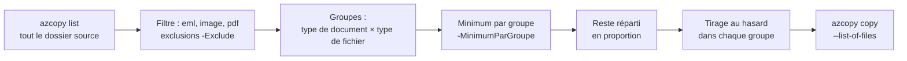

# Copier un échantillon de documents vers `incoming`

Le script [`scripts/copy-echantillon.ps1`](../scripts/copy-echantillon.ps1) copie un **échantillon
aléatoire et varié** d'un grand corpus stocké sur **Azure Files** vers le container d'entrée du
service (`incoming`). Il sert à constituer un jeu de test représentatif, par exemple 10 000
documents tirés d'un corpus de plusieurs centaines de milliers.

Chaque fichier copié dans `incoming` déclenche un **traitement complet** (OCR, agents IA) :
commencez toujours par un petit échantillon (voir [Démarche conseillée](#démarche-conseillée)).

## Sommaire

- [Prérequis](#prérequis)
- [Comment l'échantillon est tiré](#comment-léchantillon-est-tiré)
- [Paramètres](#paramètres)
- [Authentification](#authentification)
- [Exemples](#exemples)
- [Suivi de la progression](#suivi-de-la-progression)
- [Fichiers produits](#fichiers-produits)
- [Démarche conseillée](#démarche-conseillée)
- [Dépannage](#dépannage)

## Prérequis

| Prérequis | Détail |
|---|---|
| Windows PowerShell 5.1 ou PowerShell 7 | Le script est enregistré en UTF-8 avec BOM (accents corrects sous 5.1). |
| **AzCopy v10** | `winget install --id Microsoft.Azure.AZCopy.10 -e`, puis rouvrir le terminal. Vérifier : `azcopy --version`. |
| CLI Azure | Seulement avec la connexion par défaut `-AutoLogin AZCLI` (`az login`). |
| Droits sur la source | Lecture et liste du partage : jeton SAS (`rl`), ou rôle *Storage File Data Privileged Reader* avec une connexion Entra ID. |
| Droits sur la destination | Écriture dans le container : jeton SAS, ou rôle *Storage Blob Data Contributor*. |

## Comment l'échantillon est tiré



1. **Liste** : tous les fichiers du dossier source et de ses sous-dossiers (`azcopy list`), ou une
   liste déjà obtenue (`-ListFile`).
2. **Filtre** : seuls les types traités par le service sont gardés.

   | Type de fichier | Extensions (casse ignorée) |
   |---|---|
   | `eml` | `.eml` |
   | `image` | `.jpg` `.jpeg` `.png` `.heic` `.heif` `.tif` `.tiff` `.webp` `.bmp` |
   | `pdf` | `.pdf` |

   Tout le reste est écarté : en particulier les fichiers `.json` posés à côté des documents
   (`….pdf.json`), et les noms qui correspondent à `-Exclude`.
3. **Groupes** : chaque fichier est rangé selon son **type de document**, c'est-à-dire le début du
   nom **jusqu'au premier « - »**, et son **type de fichier**.

   | Nom du fichier | Type de document (`-GroupBy Complet`) | `-GroupBy Principal` |
   |---|---|---|
   | `Acte de deces + Facture - 9185575 - 9296581.eml` | `acte de deces + facture` | `acte de deces` |
   | `Acte de naissance - 695ba3f752928 - 695ba3f75292a.pdf` | `acte de naissance` | `acte de naissance` |
   | `9613781 - 9724812.pdf` (aucune lettre avant « - ») | `(sans type)` | `(sans type)` |
   | `scan.pdf` (pas de « - ») | `(sans type)` | `(sans type)` |

4. **Répartition** : chaque groupe reçoit d'abord `-MinimumParGroupe` fichiers (ou tous s'il en a
   moins), pour qu'aucun petit groupe ne soit oublié. Le reste est réparti **en proportion** de la
   taille des groupes, pour atteindre **exactement** `-Total` fichiers. Si le total est trop petit
   pour le minimum, celui-ci est réduit automatiquement.
5. **Tirage** : les fichiers sont tirés **au hasard** dans chaque groupe. La graine (`-Seed`) est
   affichée : la même graine redonne exactement le même échantillon.

**Exemple chiffré** : 26 000 fichiers retenus, dont 10 000 « facture, pdf » et 40 « relevé, image »,
pour un total de 10 000 et un minimum de 5. Chaque groupe reçoit d'abord 5 fichiers ; « facture,
pdf » représente environ 38 % de la place restante et en reçoit environ 3 800 ; « relevé, image »
en reçoit une quinzaine. Pour équilibrer davantage, augmentez `-MinimumParGroupe` (par exemple 200).

## Paramètres

| Paramètre | Défaut | Rôle |
|---|---|---|
| `-Source` | `https://corpusdocuments.file.core.windows.net/corpusdocumentsshare/qualification_sante` | Dossier source sur Azure Files. |
| `-Destination` | `https://stpseudodevivysdata.blob.core.windows.net/incoming` | Container de destination, avec un dossier facultatif (`…/incoming/lot1`). L'arborescence de la source est conservée dessous. |
| `-SourceSas` | vide | Jeton SAS de la source (lecture + liste), avec ou sans `?`. |
| `-DestinationSas` | vide | Jeton SAS de la destination (écriture). |
| `-AutoLogin` | `AZCLI` | Connexion d'AzCopy quand un jeton manque, sans question : `AZCLI` (session `az login`), `DEVICE` (code à saisir sur microsoft.com/devicelogin), `PSCRED` (`Connect-AzAccount`), ou `""` pour une session `azcopy login` ouverte avant. |
| `-TenantId` | vide | Tenant Entra ID de la connexion. Avec `AZCLI`, le script s'arrête si `az login` est sur un autre tenant. |
| `-Total` | `10000` | Nombre de fichiers à copier. |
| `-MinimumParGroupe` | `5` | Minimum de fichiers par groupe. |
| `-GroupBy` | `Complet` | `Complet` : type de document entier. `Principal` : partie avant le premier « + » (moins de groupes). |
| `-Seed` | tirée au hasard | Graine du tirage, pour refaire le même échantillon. |
| `-Exclude` | vide | Expression régulière sur le **nom** du fichier ; les fichiers qui correspondent sont écartés. `(?i)` ignore la casse. |
| `-ListFile` | vide | Liste déjà obtenue (un chemin relatif à `-Source` par ligne), au lieu de relister la source. |
| `-OutDir` | `.\echantillon` | Dossier des fichiers produits. |
| `-ProgressEvery` | `10` | Rafraîchit les compteurs tous les N fichiers (au plus 4 fois par seconde). |
| `-NoEstimate` | — | N'essaie pas d'estimer le nombre de fichiers avant la liste. |
| `-SampleOnly` | — | S'arrête après le tirage : rien n'est copié. |
| `-DryRun` | — | AzCopy simule la copie (`--dry-run`) : rien n'est copié. |
| `-NoOverwrite` | — | Ne recopie pas un fichier déjà présent dans la destination : relancer le même tirage ne retraite pas les fichiers déjà copiés. |
| `-Force` | — | Pas de demande de confirmation avant la copie. |

L'aide complète est aussi dans le script : `Get-Help ./scripts/copy-echantillon.ps1 -Full`.

## Authentification

AzCopy doit pouvoir **lire la source** et **écrire dans la destination**. Sans connexion valide, il
pose une question (« Reauthorize and continue? ») que le script ne voit pas : il resterait bloqué.
D'où l'option `-AutoLogin`, ou les jetons SAS.

| Situation | Recommandation |
|---|---|
| Source et destination dans le **même tenant** | Une seule connexion Entra ID : `az login --tenant <tenant>` puis `-TenantId <tenant>` (option par défaut `AZCLI`). |
| Source et destination dans des **tenants différents** | Une connexion ne peut pas servir aux deux : jeton SAS sur la source (`-SourceSas`), connexion Entra ID pour la destination. |
| Partage Azure Files avec une connexion Entra ID qui échoue | Jeton SAS sur la source : c'est le plus fiable pour Azure Files. |

Générer un jeton SAS de lecture sur le partage (expire le 20/10/2026 ici, à adapter) :

```powershell
az storage share generate-sas --account-name corpusdocuments --name corpusdocumentsshare --permissions rl --expiry 2026-10-20 --https-only -o tsv
```

Un jeton SAS donne accès aux données : ne le collez dans aucun fichier ni message, et donnez-lui une
expiration courte.

## Exemples

**1. Voir l'échantillon, sans rien copier** (liste de la source, tirage, répartition) :

```powershell
./scripts/copy-echantillon.ps1 -SourceSas "?<jeton>" -SampleOnly
```

**2. Comparer les deux regroupements sans relister la source** (la liste est gardée dans
`echantillon\source.txt` après le premier passage) :

```powershell
./scripts/copy-echantillon.ps1 -ListFile .\echantillon\source.txt -SampleOnly -GroupBy Principal -OutDir .\echantillon-principal
```

**3. Essai réel sur 100 fichiers, reproductible** :

```powershell
./scripts/copy-echantillon.ps1 -SourceSas "?<jeton>" -Total 100 -Seed 42
```

**4. Écarter les décomptes** (decompte, Décompte, DECOMPTE) :

```powershell
./scripts/copy-echantillon.ps1 -SourceSas "?<jeton>" -Exclude '(?i)d[ée]compte' -SampleOnly
```

Plusieurs mots : `-Exclude '(?i)(d[ée]compte|relance|avoir)'`.

**5. Échantillon plus équilibré entre les groupes** :

```powershell
./scripts/copy-echantillon.ps1 -SourceSas "?<jeton>" -MinimumParGroupe 200 -SampleOnly
```

**6. Simuler la copie avec AzCopy** (vérifie les droits et les chemins, sans rien copier) :

```powershell
./scripts/copy-echantillon.ps1 -SourceSas "?<jeton>" -Total 100 -Seed 42 -DryRun
```

**7. Connexion par la CLI Azure, en vérifiant le tenant** :

```powershell
az login --tenant 87403574-1718-4e11-9d35-b91a4ba49fa9
```

```powershell
./scripts/copy-echantillon.ps1 -TenantId 87403574-1718-4e11-9d35-b91a4ba49fa9 -SampleOnly
```

**8. Autre source, dans un sous-dossier de destination** (pour séparer les lots) :

```powershell
./scripts/copy-echantillon.ps1 -Source "https://autre.file.core.windows.net/partage/dossier" -Destination "https://stpseudodevivysdata.blob.core.windows.net/incoming/lot2" -SourceSas "?<jeton>"
```

**9. Copie complète de 10 000 fichiers sans confirmation** (après validation des étapes
précédentes) :

```powershell
./scripts/copy-echantillon.ps1 -SourceSas "?<jeton>" -Exclude '(?i)d[ée]compte' -Seed 42 -Force
```

## Suivi de la progression

Trois barres de progression s'affichent l'une après l'autre, rafraîchies tous les `-ProgressEvery`
fichiers (10 par défaut), au plus 4 fois par seconde : l'affichage ralentirait sinon le script sous
Windows PowerShell 5.1.

| Étape | Ce qui est affiché |
|---|---|
| Liste de la source | Nombre de fichiers déjà listés : `12 340 fichier(s) listé(s)`. Avec une estimation : `12 340 / ~85 000` et un pourcentage. |
| Filtre et classement | Fichiers examinés sur le total, et nombre retenu. |
| Tirage de l'échantillon | `6 120 / 10 000 tiré(s) - eml 1 830, image 1 210, pdf 3 080 - reste 3 880`, et le groupe en cours (`Groupe 7 / 16 : acte de deces (pdf), 420 sur 1 100`). |

**Nombre total avant la liste.** Azure Files ne donne pas le nombre de fichiers d'un dossier sans le
parcourir. Le script essaie d'afficher une **estimation** à partir de la métrique Azure Monitor
`FileCount` du partage :
- elle porte sur **tout le partage** (tous les dossiers, fichiers `.json` compris) : elle dépasse le
  nombre de fichiers du dossier source, et le pourcentage n'est qu'indicatif ;
- elle est mise à jour environ toutes les heures ;
- elle demande la CLI Azure connectée à l'abonnement du compte source et le droit de lire ses
  métriques (rôle *Monitoring Reader* ou *Reader*). Sinon, le compteur avance sans pourcentage ;
- `-NoEstimate` désactive cet essai.

La copie elle-même est suivie par l'affichage d'AzCopy (fichiers copiés, débit, restant).

## Fichiers produits

Dans `-OutDir` (`.\echantillon` par défaut) :

| Fichier | Contenu |
|---|---|
| `source.txt` | Tous les fichiers listés dans la source (un chemin par ligne), réutilisable avec `-ListFile`. Absent si `-ListFile` est utilisé. |
| `echantillon.txt` | Les fichiers tirés, au format attendu par `azcopy copy --list-of-files` (UTF-8 sans BOM). |
| `echantillon.csv` | Chaque fichier tiré, avec son type de document et son type de fichier. |
| `repartition.csv` | Pour chaque groupe : type de document, type de fichier, nombre de fichiers disponibles et retenus. |

Ces fichiers contiennent des **noms de fichiers**, qui peuvent comporter des données personnelles :
ne les commitez pas et supprimez-les après usage.

## Démarche conseillée

1. `-SampleOnly` : vérifier la répartition (`repartition.csv`) et ajuster `-GroupBy`,
   `-MinimumParGroupe` et `-Exclude`.
2. `-Total 100 -Seed 42` : copie réelle d'un petit lot. Vérifier dans `pseudonymised/` et
   `quarantine/` que les documents sont traités, le taux de quarantaine et le coût.
3. Copie complète, si possible **par tranches** (par exemple 5 lots de 2 000 avec des graines
   différentes, ou un `-Total` croissant) pour suivre le coût et ne pas saturer le quota Azure OpenAI.

Ordre de grandeur du coût : 0,23 € mesurés pour 117 pages, soit environ **60 € pour 10 000 documents
de 2 à 3 pages** (OCR et agents IA).

**Nature des données** : le déploiement de test (abonnement personnel, modèle en `GlobalStandard`,
réseau public) est réservé aux **données fictives**. De vrais documents de santé doivent être
traités dans l'environnement de l'organisation (`DataZoneStandard`, réseau privé, accord du DPO).

## Dépannage

| Symptôme | Cause | Solution |
|---|---|---|
| `azcopy : Le terme «azcopy» n'est pas reconnu` | AzCopy n'est pas installé, ou pas dans le PATH. | `winget install --id Microsoft.Azure.AZCopy.10 -e`, puis rouvrir le terminal. |
| Bloqué sur « Authentication is required… Reauthorize and continue? » | Aucune connexion valide pour AzCopy. | `-SourceSas`, ou `az login` puis `-TenantId`, ou `azcopy login` puis `-AutoLogin ""`. |
| « Aucun fichier reconnu dans la sortie d'azcopy list » | Format de sortie d'AzCopy inattendu. | Le script affiche les premières lignes reçues : les transmettre pour adapter la lecture. |
| « La session az login est sur le tenant … » | `az login` est connecté à un autre tenant (par exemple celui de l'entreprise). | `az login --tenant <tenant>`. |
| `azcopy list a échoué` | Droits insuffisants, jeton expiré ou URL incorrecte. | Vérifier le jeton SAS (droits `rl`, expiration) ou le rôle sur le compte source. |
| Les fichiers copiés ne sont pas traités | Le filtre Event Grid ne retient pas ce type d'écriture. | Vérifier avec un seul fichier ; si besoin, compléter le filtre `data.api` dans `infra/messaging.tf`. |
| Erreurs `404 ResourceNotFound` sur les noms accentués, affichés `rembours├®s` | Ancienne version du script : la sortie d'AzCopy (UTF-8) était lue avec l'encodage de la console (page de code 850). | Corrigé : la lecture est forcée en UTF-8. Relister la source (ne pas réutiliser l'ancien `source.txt` avec `-ListFile`, ses noms sont faux). |
| Copie interrompue | Coupure réseau, poste mis en veille. | `azcopy jobs list` puis `azcopy jobs resume <id>` (avec le même jeton SAS si besoin : `--source-sas`). |
