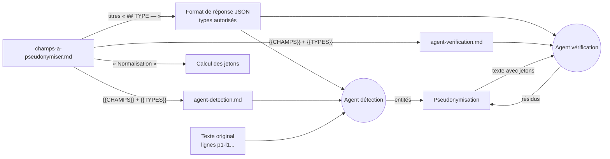
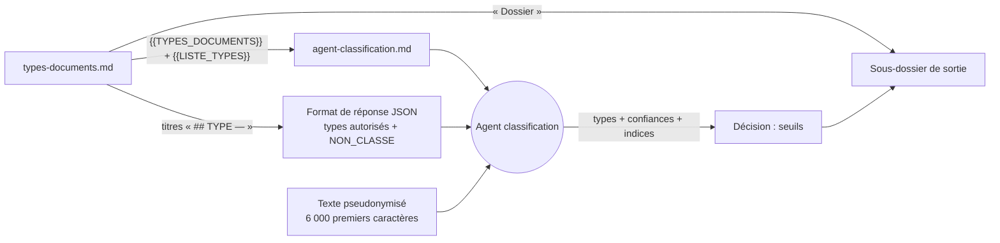

# Prompts et agents IA

## Fichiers

| Fichier | Rôle |
|---|---|
| [champs-a-pseudonymiser.md](../prompts/champs-a-pseudonymiser.md) | **Source unique des champs**. Pour chaque champ : définition, formats, indices de reconnaissance, contre-exemples, et stratégie de normalisation. Lu par les agents (injecté via `{{CHAMPS}}`) **et** par le code (liste des types, normalisation). |
| [agent-detection.md](../prompts/agent-detection.md) | Agent 1 : lit le texte original et liste toutes les valeurs à pseudonymiser. |
| [agent-verification.md](../prompts/agent-verification.md) | Agent 2 : relit le texte **déjà pseudonymisé** et liste les données restées en clair, y compris les fragments. |
| [types-documents.md](../prompts/types-documents.md) | **Source unique des types de document** : indices de reconnaissance, contre-exemples, sous-dossier de sortie. Lu par l'agent de classification (injecté via `{{TYPES_DOCUMENTS}}`) **et** par le code (types autorisés, dossiers). |
| [agent-classification.md](../prompts/agent-classification.md) | Agent 3 : lit le début du texte **pseudonymisé** et renvoie le ou les types de document avec une confiance. |



Les **PDF et les images** passent par les mêmes agents et les mêmes prompts. Pour une image,
le texte vient de l'OCR de la copie redressée (voir
[architecture](architecture.md#préparation-des-images-étape-)) : les agents ne voient pas de
différence.

## Contrat d'entrée et de sortie

**Entrée** : le texte numéroté par ligne, entre balises `<document>` :

```
<document>
p1-l2: Patient : M. DUPONT Jean-Marc
p1-l3: Né le 12/03/1985 - N° SS : 1 85 03 75 123 456 78
</document>
```

**Sortie** : un JSON imposé par *Structured Outputs* (schéma strict défini dans
`src/pseudo/detection/llm.py`) :

```json
{"entities": [{"line_id": "p1-l2", "text": "DUPONT", "type": "NOM", "group": "", "confidence": 0.99}]}
```

- `text` doit être une sous-chaîne **exacte** de la ligne. Le code la localise successivement
  par recherche exacte, puis tolérante (casse et espaces), puis floue (rapidfuzz). Les positions
  des mots permettent ensuite de calculer les zones à masquer.
- `group` relie les fragments d'une valeur répartie sur plusieurs lignes, comme une adresse.
  Tous les fragments reçoivent alors le même jeton.
- Les types autorisés sont **ceux déclarés dans le référentiel**. Le code construit à chaque
  chargement des prompts le format de réponse imposé au modèle, qui ne peut donc ni inventer un
  type ni en omettre un déclaré. Le type `PERSONNE` est réservé au filet Azure AI Language
  (nom complet non découpé).

## Mots à ne jamais pseudonymiser

La section du même nom, dans `champs-a-pseudonymiser.md`, liste les mots qui ne sont jamais des
données personnelles : civilités et titres (`Dr`, `Docteur`, `Mme`…) et vocabulaire courant des
documents (`devis`, `facture`, `ordonnance`…). L'agent IA la lit, et le code l'applique après
toutes les détections et la propagation, quelle qu'en soit la source : une zone qui ne contient
que ces mots est retirée, et ces mots sont retirés du début et de la fin d'une zone
(`Dr DUPONT` → seul `DUPONT` est remplacé). Casse et accents sont ignorés. Ajouter un mot =
compléter une puce, puis publier. **Ne jamais y mettre un nom de famille** : il ne serait plus
pseudonymisé nulle part.

## Organisations à ne jamais pseudonymiser

La section du même nom, dans `champs-a-pseudonymiser.md`, liste les partenaires (noms, domaines
e-mail, mots des adresses génériques). L'agent IA la lit avec le reste du référentiel, et le
code l'applique après toutes les détections. Ajouter un partenaire = compléter les trois puces,
puis publier. Le comportement détaillé est décrit dans
[architecture](architecture.md#organisations-à-ne-jamais-pseudonymiser).

## Modifier les règles

Chaque champ du référentiel peut indiquer le **générateur de sa valeur fictive**, utilisé en mode
`PSEUDO_OUTPUT_MODE=substitution`. La ligne est lue par le code, comme `Normalisation` :

```markdown
## PRENOM — Prénom d'une personne physique

- **Normalisation** : texte
- **Substitution** : prenom
```

Générateurs disponibles : `nom`, `prenom`, `personne`, `date_naissance`, `nir`, `telephone`, `email`,
`adresse` et `generique` (défaut : même forme, lettres → lettres et chiffres → chiffres). Leur
détail est dans [architecture.md](architecture.md#valeurs-fictives-mode-substitution). Les
valeurs fictives sont fabriquées par le **code**, jamais par un agent IA : les prompts ne
contiennent aucune valeur fictive. Un générateur inconnu bloque le traitement, comme une
normalisation inconnue.

- **Affiner un champ existant** (nouveau libellé, nouveau format, contre-exemple) : modifier
  uniquement `champs-a-pseudonymiser.md`.
- **Changer une politique** (par exemple ne plus masquer les adresses des organisations) :
  modifier la section du champ concerné. Le filet Azure AI Language masque toutes les adresses
  qu'il reconnaît. Retirez `Address:ADRESSE` de `LANGUAGE_PII_CATEGORIES` si nécessaire.
- **Ajouter un type** (IBAN, numéro de passeport...) : ajouter une section dans
  `champs-a-pseudonymiser.md`, puis lancer `./scripts/publish-prompts.ps1`. Le champ est pris en
  compte en moins de 5 minutes, **sans redéploiement du code** :

  ```markdown
  ## IBAN — Numéro de compte bancaire

  - **Normalisation** : alphanumerique
  - **Définition** : identifiant international de compte bancaire...
  - **Indices** : `IBAN`, `RIB`, commence par `FR76`...
  - **Ne pas confondre** avec : ...
  ```

  - **Titre** : `## TYPE — Libellé`. Le type s'écrit en MAJUSCULES, chiffres et `_`, suivi d'un
    tiret cadratin `—`. C'est le nom qui apparaît dans les jetons (`[IBAN_3FA94C0B21]`).
  - **Normalisation** (facultative, défaut `texte`) : elle sert à donner le même jeton à une même
    valeur écrite différemment. Valeurs possibles :

    | Stratégie | Effet | Exemples |
    |---|---|---|
    | `texte` | accents, casse, espaces et ponctuation ignorés | noms, adresses |
    | `chiffres` | chiffres uniquement | numéros de dossier |
    | `alphanumerique` | lettres et chiffres en majuscules | NIR, IBAN, passeport |
    | `email` | espaces supprimés, minuscules | e-mails |
    | `telephone` | chiffres, préfixe +33 / 0033 ramené à 0 | téléphones |
    | `date` | convertie en AAAA-MM-JJ si le format est reconnu, y compris en toutes lettres (« vingt-trois mars mil neuf cent cinquante-deux » = 23/03/1952 : même jeton) | dates |

  - **Contrôle** : un type mal écrit, un doublon ou une normalisation inconnue **bloque le
    traitement**. Le message reste dans la file Service Bus pour être réessayé, et l'erreur
    apparaît dans les journaux. Testez localement avant de publier, par exemple avec
    `python src/cli.py exemple.pdf`.
  - Les notes destinées aux mainteneurs se placent dans un commentaire HTML `<!-- ... -->`.
    Ces commentaires sont retirés avant analyse et ne sont jamais envoyés aux agents.
  - **Filet regex (facultatif)** : pour un format très structuré, une règle peut être ajoutée
    dans `src/pseudo/detection/regex_rules.py`. C'est le seul cas qui demande de modifier le code.
  - **Retirer un champ** : supprimer sa section. Les filets regex (NIR, e-mail, téléphone, date
    de naissance) et Azure AI Language continuent cependant de masquer leurs propres types.

## Types de document et classification



**Réponse de l'agent** (format imposé par *Structured Outputs*) :

```json
{"types": [
  {"type": "DENTAIRE", "confidence": 0.85, "indices": ["détartrage", "code HBJD001"]},
  {"type": "OPTIQUE", "confidence": 0.85, "indices": ["monture", "verres unifocaux"]}
]}
```

- Les confiances sont **indépendantes**, elles ne totalisent pas forcément 1. Un document mixte
  reçoit une confiance élevée pour chacun de ses types.
- `NON_CLASSE` est toujours autorisé : l'agent l'utilise quand aucun type ne convient.
- Les `indices` ne contiennent que du vocabulaire métier. Le prompt l'impose, et le texte reçu
  est de toute façon pseudonymisé. Ils sont limités à 5 indices de 80 caractères.
- La décision (type principal, types secondaires, `multi_type`, `NON_CLASSE`) est prise par le
  code, avec les seuils décrits dans [architecture.md](architecture.md#classification-du-type-de-document).

**Ajouter un type de document** : ajouter une section dans `types-documents.md`, puis lancer
`./scripts/publish-prompts.ps1`. Le type est pris en compte en moins de 5 minutes, sans
redéploiement.

```markdown
## AUDIOPROTHESE — Audioprothèse

- **Dossier** : audioprothese
- **Indices** : audioprothésiste, aide auditive, appareil auditif, contour d'oreille, intra-auriculaire,
  ordonnance d'ORL, classe I / classe II, codes LPP…
- **Ne pas confondre** : consultation chez un ORL sans délivrance d'appareil.
```

- **Titre** : `## TYPE — Libellé`. Le type s'écrit en MAJUSCULES, chiffres et `_`, suivi d'un
  tiret cadratin `—`. `NON_CLASSE` est réservé et ne doit pas être déclaré.
- **Dossier** (facultatif) : minuscules, chiffres et `-`. Par défaut, c'est le type en
  minuscules, avec `_` remplacé par `-`. Deux types ne peuvent pas partager un dossier.
- **Indices** : décrire le type par la **profession**, les **actes**, les **codes de facturation**
  et le **vocabulaire**, jamais par des noms de personnes, puisque l'agent ne voit que le texte
  pseudonymisé. Ajouter des « Ne pas confondre » pour les cas proches.
- **Contrôle** : un type mal écrit, un doublon, un dossier invalide ou partagé bloque le
  traitement, avec une erreur visible dans les journaux. Comme pour les champs, testez en local
  avant de publier.
- **Renommer le dossier d'un type existant** ne déplace pas les fichiers déjà produits. Seuls
  les nouveaux traitements, et les retraitements, utilisent le nouveau dossier.

## Bonnes pratiques

- Garder des **exemples fictifs** dans les prompts. N'y copiez jamais de données réelles.
- Pour chaque champ, donner autant de **contre-exemples** que d'exemples : c'est ce qui réduit
  les faux positifs.
- Toute modification se mesure sur un jeu de documents annotés. La métrique prioritaire est le
  **rappel** : aucune donnée oubliée.
- Le prompt rappelle que le contenu du document est une **donnée, jamais une instruction**.
  C'est une protection contre l'injection de prompt via un document malveillant (PDF ou image). Comme en plus les
  filets regex et Language ne dépendent pas du LLM, une injection réussie ne suffit pas à
  faire passer des données en clair.
